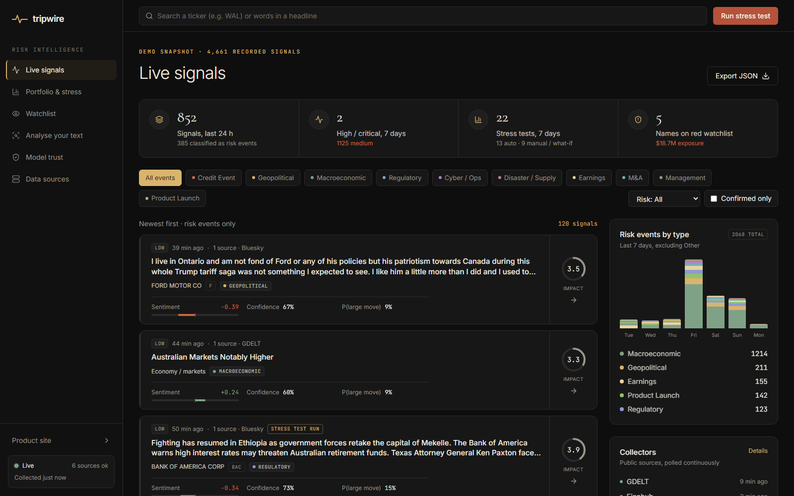
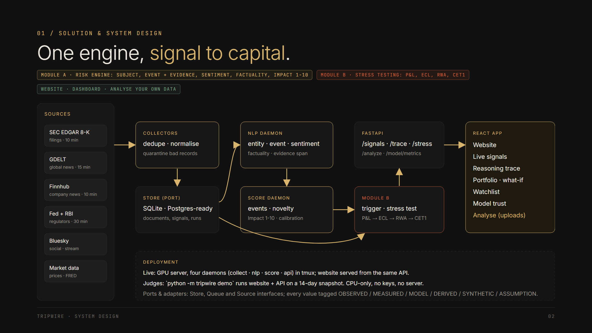
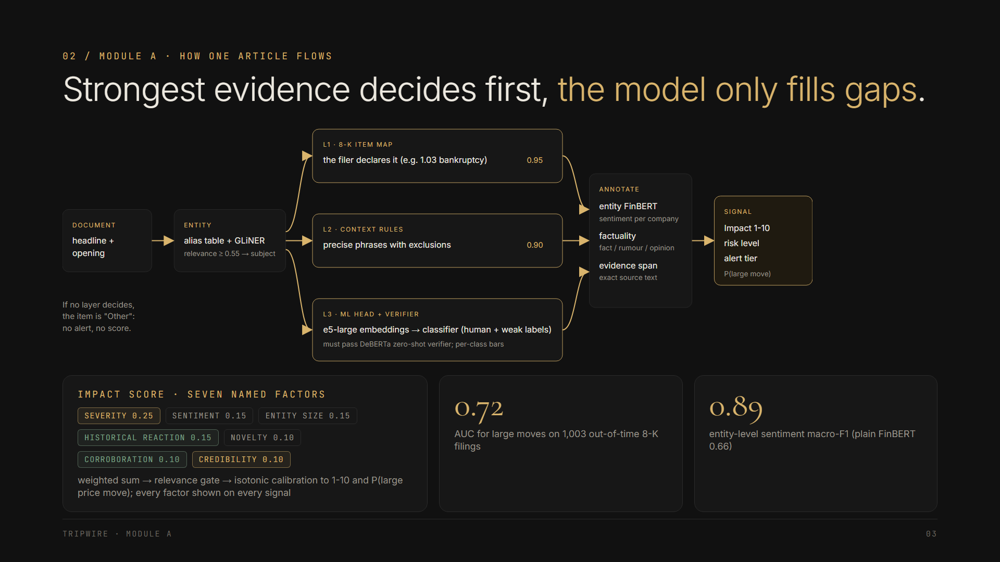
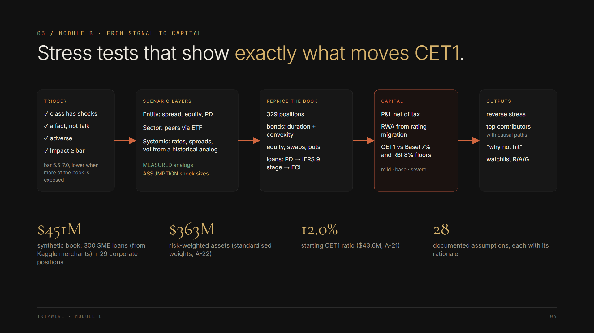
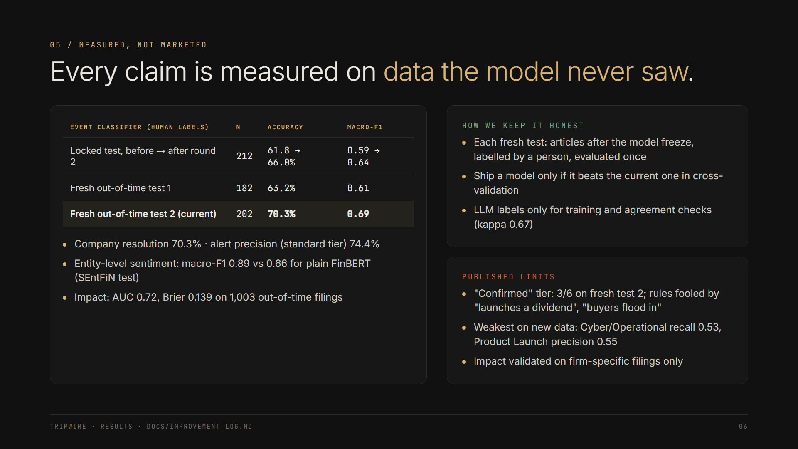
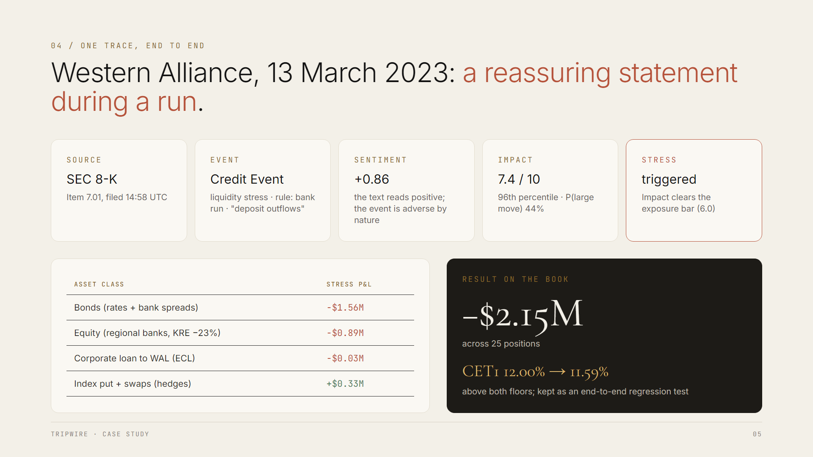
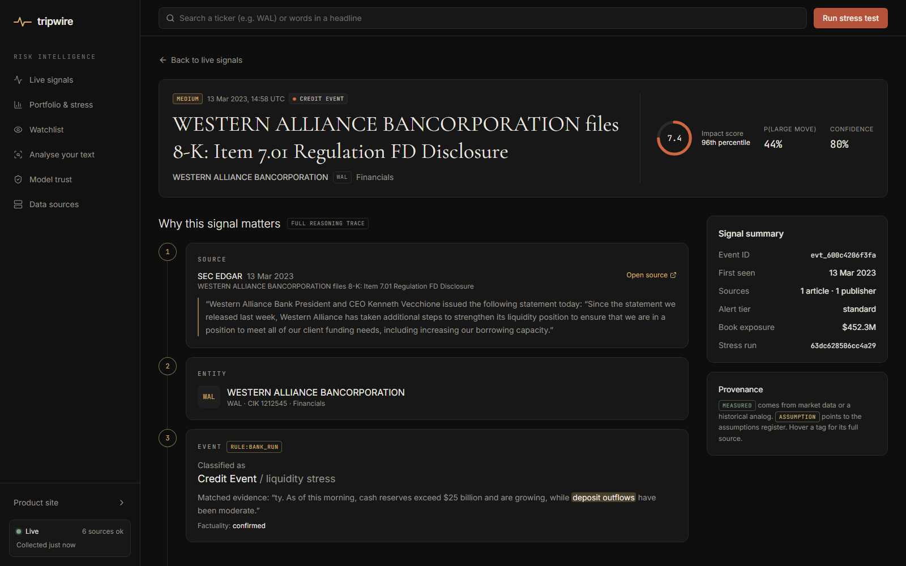
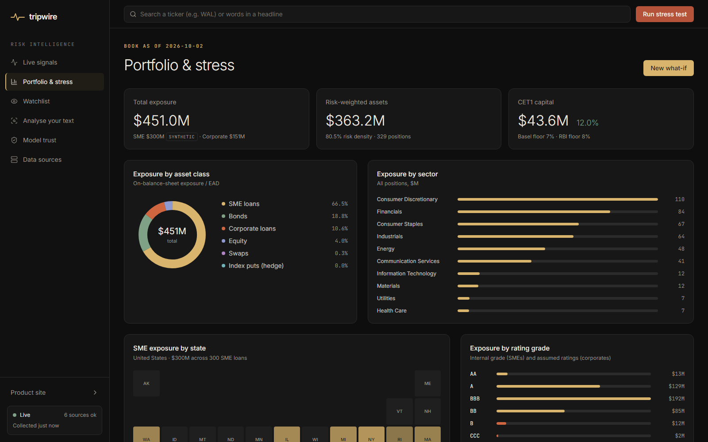
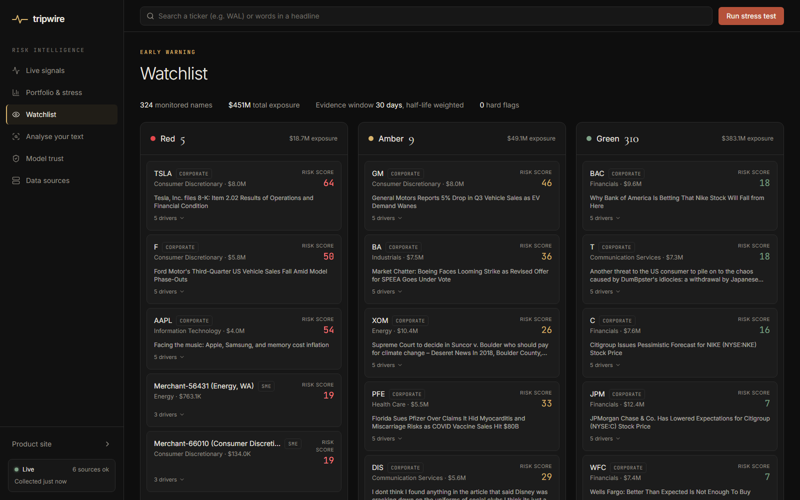
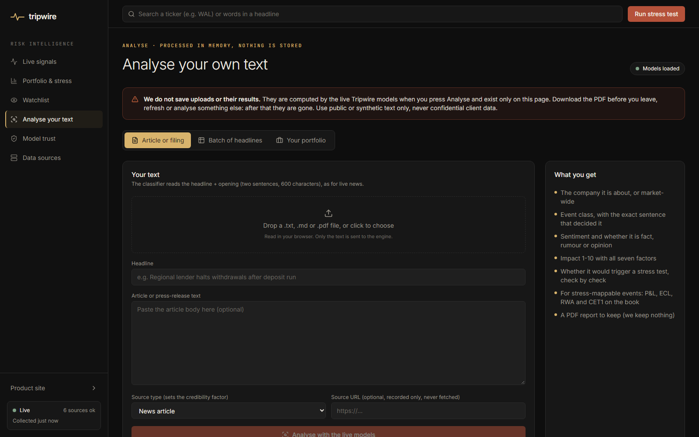

# Tripwire - S&P Global & Crisil Campus Hackathon

**Candidate Name:** Deepak Meena

**College Email ID:** deepak23188@iiitd.ac.in

**College / Campus:** Indraprastha Institute of Information Technology Delhi (IIIT Delhi)

**Demo Video Link:** https://youtu.be/cu9cIyt4K4s (YouTube, unlisted)

**Slide Deck Link (if hosted externally):** not hosted externally; the deck is [docs/presentation.pdf](docs/presentation.pdf)

<br>

> **Tripwire is an AI risk engine for banks.** It reads news, SEC filings, central-bank releases and social posts,
> decides what actually happened and how much it matters, and shows what it does to a bank's P&L, credit losses and
> CET1 capital. Every number is traceable to its source.

<br>

| | |
|---|---|
| **Live website** | https://tripwire-risk.duckdns.org (dashboard: [/app](https://tripwire-risk.duckdns.org/app)) |
| **Demo video** | https://youtu.be/cu9cIyt4K4s |
| **Run it locally** | `pip install -r requirements.txt` then `python -m tripwire demo` (no GPU, no API keys) |
| **Slide deck** | [docs/presentation.pdf](docs/presentation.pdf) (7 slides) |
| **Trained models** | in [models/](models) and the [models-v1 release](https://github.com/deepakm0003/iiitd-deepak-meena-hackathon/releases/tag/models-v1) |

<br>



<br>

## Contents

1. [Project Overview / Problem Statement & Approach](#1-project-overview--problem-statement--approach)
2. [Architecture & Tech Stack](#2-architecture--tech-stack)
3. [Dataset Used](#3-dataset-used)
4. [Quickstart & Installation](#4-quickstart--installation)
5. [Key Results & Domain Impact](#5-key-results--domain-impact)
6. [Product Tour](#6-product-tour)
7. [Repository Structure](#7-repository-structure)

<br>

## 1. Project Overview / Problem Statement & Approach

### The problem

Credit and risk teams have to react to events described in unstructured text long before those events reach
structured data. There are thousands of items a day, and the few that matter (a deposit run, a default, a sanction)
look like everything else. News also stops at the headline: nobody connects the event to the loans, bonds and
equity it moves. And a score with no evidence or measured accuracy cannot go to a credit committee.

### The solution

For every event, Tripwire answers four questions: **what happened, how much it matters, what it does to this bank's
capital, and why we believe it.**

**Module A: AI / NLP risk engine.** Turns each item into a structured, explainable risk signal:

| Output | How |
|---|---|
| **Subject** | which of 73 tracked companies the item is about, or market-wide |
| **Event class** | 11 classes, from Credit Event to Product Launch, with the exact sentence that decided it |
| **Sentiment** | towards that company (entity-level), not the whole text |
| **Factuality** | confirmed, rumour or opinion |
| **Impact score 1-10** | seven named factors, calibrated to the probability of a large price move |

**Module B: credit early warning and stress testing.**

- Decides which signals deserve a stress test, check by check.
- Applies sourced shocks to a synthetic wholesale bank book (300 SME loans, 29 large-corporate positions).
- Shows exactly what moves P&L, expected credit loss (ECL), risk-weighted assets (RWA) and CET1, against the Basel
  and RBI floors, with mild / base / severe ranges and a reverse stress test.
- Keeps a Red / Amber / Green watchlist per name.

**Analyse your own data.** The Analyse page runs the production models on a pasted article or PDF, a batch of up to
300 headlines, or an uploaded portfolio CSV. Nothing is stored; the user downloads a PDF report.

### The approach: evidence first

- **Precise sources decide first.** Official 8-K item codes and precise rules label an item before any model. The
  ML classifier only handles what they leave, and its labels must pass an independent zero-shot verifier.
- **Every number carries its provenance:** OBSERVED, MEASURED, MODEL, DERIVED, SYNTHETIC or ASSUMPTION. The 28
  assumptions are listed in [config/assumptions_register.yaml](config/assumptions_register.yaml).
- **Accuracy is reported only on human-labelled data and out-of-time tests,** including the experiments that
  failed: [docs/IMPROVEMENT_LOG.md](docs/IMPROVEMENT_LOG.md).

<br>

## 2. Architecture & Tech Stack



<br>

**Module A, how one article flows:**



<br>

**Module B, from signal to capital:**



<details>
<summary><b>The same pipeline as text</b></summary>

```
 collectors (GDELT, Finnhub, SEC EDGAR 8-K, Fed + RBI RSS, Bluesky)
        │  every 10-30 min, deduplicated
        ▼
 NLP engine  ──  entity linking (alias table + GLiNER NER) → event: 8-K item map → context rules
        │        → ML head (e5-large embeddings + logistic regression) checked by a DeBERTa zero-shot verifier
        │        → entity-level FinBERT sentiment → factuality → evidence span
        ▼
 events  ──  clustering of duplicate stories, novelty, corroboration, source credibility
        ▼
 Impact score  ──  7 factors (severity, sentiment magnitude, entity importance, novelty, corroboration,
        │          credibility, historical reaction), relevance gate, isotonic calibration
        ▼
 Module B  ──  trigger checks → scenario (entity / sector / systemic shocks, measured analogues + assumptions)
        │       → repricing of every position → ECL (IFRS 9 stages) → RWA → CET1 vs floors, reverse stress
        ▼
 FastAPI (/signals, /signals/{id}/trace, /portfolio, /watchlist, /stress-test, /analyze/*, /model/metrics)
        ▼
 React website + dashboard
```

</details>

<br>

### Tech stack

| Layer | Technology |
|---|---|
| Backend | Python 3.11, FastAPI, Pydantic, SQLAlchemy (SQLite; PostgreSQL-ready through the `Store` port) |
| NLP / ML | sentence-transformers, transformers, scikit-learn, GLiNER, PyTorch (CPU is enough to run) |
| Frontend | React 19, Vite, TypeScript, Tailwind CSS v4, Framer Motion; PDF reports with jsPDF in the browser |
| Design | Ports and adapters for the store, queue and sources ([docs/adr](docs/adr)) |
| Deployment | AWS EC2 + Caddy (HTTPS), one script: [deploy/ec2_setup.sh](deploy/ec2_setup.sh) |

### Models

All are open source, and none of them generates text.

| Model | Role |
|---|---|
| `intfloat/e5-large-v2` + our trained head ([models/event_head.pkl](models/event_head.pkl)) | Event classifier |
| `MoritzLaurer/deberta-v3-base-zeroshot-v2.0` | Independent verifier of the classifier's labels |
| FinBERT fine-tuned on (sentence, company) pairs from SEntFiN ([release](https://github.com/deepakm0003/iiitd-deepak-meena-hackathon/releases/tag/models-v1)) | Entity-level sentiment |
| `urchade/gliner_multi-v2.1` | Named-entity recognition |
| Our Impact calibration ([models/impact_model.json](models/impact_model.json)) | Impact score 1-10 and P(large move) |

Module B method: [docs/module_b.md](docs/module_b.md).

<br>

## 3. Dataset Used

Every data file the prototype uses is in [data/](data), described file by file in [data/README.md](data/README.md).
Nothing is proprietary or confidential client data.

| Data | Source | Nature |
|---|---|---|
| Live text: news, 8-K filings, central-bank releases, social posts | GDELT 2.0, Finnhub, SEC EDGAR, Federal Reserve and RBI RSS, Bluesky | Public, collected every 10-30 minutes |
| Demo snapshot ([data/demo](data/demo)) | The live system's last 14 days: 4,661 signals, their stress runs, price history | Public (derived) |
| Bank book ([data/book.json](data/book.json)) | 300 SME loans derived from the Kaggle merchants + 29 positions on public names | **Synthetic** |
| Merchant features ([data/merchant_features.csv](data/merchant_features.csv)) | Kaggle "Financial Transactions Dataset: Analytics" (Apache 2.0) | Aggregates only |
| Market data | Yahoo Finance (yfinance), FRED | Public |
| Labels ([data/gold](data/gold)) | 680 items labelled by hand with [docs/labeling_guide.md](docs/labeling_guide.md) | Human labels |

**Assumptions about the data**

- The bank book is synthetic: exposures, grades and capital are assumptions, each one listed in the
  [assumptions register](config/assumptions_register.yaml).
- The SME loans use card-transaction behaviour as a proxy for credit risk. That is a proxy event, not a probability
  of default.
- The raw Kaggle files are not redistributed (they include card-like fields); only aggregates are used. The data
  profile is in [docs/data_profile.md](docs/data_profile.md).
- Salad Money Open Banking data (listed in the case study) was not used: access is restricted to a UK Trusted
  Research Environment.
- LLM-assisted (silver) labels are used only for training and agreement checks, never to report accuracy
  ([docs/ai_usage.md](docs/ai_usage.md)).

<br>

## 4. Quickstart & Installation

**Runtime:** Python 3.11 on Windows 11 or Linux (Ubuntu). No GPU, no API keys and no Node.js needed.

```bash
git clone https://github.com/deepakm0003/iiitd-deepak-meena-hackathon.git
cd iiitd-deepak-meena-hackathon
python -m venv .venv
.venv\Scripts\activate          # Windows  (Linux / macOS: source .venv/bin/activate)
pip install -r requirements.txt
python -m tripwire demo
```

This opens **http://127.0.0.1:8000**: the website, and the dashboard at **/app**, running on the snapshot of real
data in [data/demo](data/demo). Dates are shown as of the snapshot time.

<br>

### The Analyse page (optional, about 2.5 GB of models)

To analyse your own text and portfolios with the real models:

```bash
pip install -r requirements-research.txt
python -m tripwire fetch-models --base
python -m tripwire demo
```

- `fetch-models` downloads our fine-tuned sentiment model from the GitHub release (checked by SHA-256) and the
  open-source base models from Hugging Face.
- The models load in a few minutes on CPU. Without them, everything else works and the page says what to install.

<br>

### Options and other commands

| Command | What it does |
|---|---|
| `python -m tripwire demo --port 8001` | Use another port (also `--host 0.0.0.0`, `--reset`, `--no-analyze`, `--no-browser`) |
| `pip install -r requirements-dev.txt && pytest` | Run the test suite (286 tests, including the end-to-end golden case) |
| `cd frontend && npm install && npm run dev` | Frontend development server (the built site is already in `frontend/dist`) |

<details>
<summary><b>Running the full live system (what the deployed server runs)</b></summary>

<br>

| Command | What it does |
|---|---|
| `python -m tripwire collect --live --daemon` | All collectors continuously (needs `.env`, see `.env.example`) |
| `python -m tripwire nlp --daemon` | Annotate new documents (entities, event, sentiment, factuality, evidence) |
| `python -m tripwire score --daemon` | Cluster into events, score Impact, run automatic stress tests |
| `python -m tripwire api` | The API (OpenAPI docs at /docs) |
| `python -m tripwire calibrate` | Re-fit the Impact calibration and validate it out of time |
| `python -m tripwire train-head --encoder intfloat/e5-large-v2` | Retrain the event head |
| `python -m tripwire train-sentiment` | Retrain the entity-sentiment model |
| `python -m tripwire eval-gold --labels <file> --candidates <file>` | Evaluate on a human-labelled set |
| `python -m tripwire status` | Store counts and collector health |

</details>

<br>

## 5. Key Results & Domain Impact

All figures are measured on held-out human-labelled data or out-of-time market data, with sample sizes. The full
history, including negative results, is in [docs/IMPROVEMENT_LOG.md](docs/IMPROVEMENT_LOG.md); the raw outputs are in
[docs/results](docs/results).



<br>

### Event classifier

| Evaluation | n | Accuracy | Macro-F1 | Company resolution |
|---|---|---|---|---|
| Locked human test, evaluated once (before -> after round 2) | 212 | 61.8% -> **66.0%** | 0.59 -> **0.64** | 75.9% |
| Fresh out-of-time test 1 (articles after the round-2 freeze) | 182 | 63.2% | 0.61 | 66.5% |
| **Fresh out-of-time test 2 (articles after the e5 freeze)** | 202 | **70.3%** | **0.69** | **70.3%** |

- "Fresh" test sets contain only articles published after the model was frozen, labelled by hand and evaluated once.
- On fresh test 2, alerts outside the confirmed tier were 74.4% precise (96 of 129).
- The current model adds two rule fixes found on that test and is retrained on all 680 human labels. 5-fold
  cross-validation over the 680 labels gives 75.6% (75.2% before the fixes). That is a development estimate; the
  honest out-of-time number is the 70.3% above.

### Impact score

On 1,003 SEC 8-K filings published after the calibration window:

| Metric | Value |
|---|---|
| AUC for large abnormal price moves (base rate 19%) | **0.72** |
| Spearman correlation | 0.32 |
| Brier score (no-skill forecast: 0.155) | 0.139 |

### Sentiment

Entity-level FinBERT on the SEntFiN held-out test set:

| Test | Ours | Plain FinBERT |
|---|---|---|
| All headlines (n = 1,464), macro-F1 | **0.89** | 0.66 |
| Headlines where two companies get opposite sentiment (n = 300) | **0.84** | 0.44 |

<br>

### Domain impact: one trace from source to capital



- **The example:** a Western Alliance 8-K during the March 2023 regional-bank stress. It is classified as a Credit
  Event (liquidity stress) from the evidence sentence and gets Impact 7.4. Stress-tested on the book, it costs
  **−$2.15M** of P&L and moves **CET1 from 12.00% to 11.59%**. It is kept as an end-to-end regression test in
  [tests/golden](tests/golden).
- **Nature beats tone:** the bank's own reassuring statement (sentiment +0.86) still triggers, because the event is
  adverse by nature. A tone-only system would have missed it.
- **Why it matters:** a credit team gets a short list of what actually matters, with the evidence, a number for how
  much it matters and the effect on their own capital, instead of reading thousands of headlines.

### Honest limits

These are also published on the dashboard's Model trust page.

- The weakest classes on fresh test 2 are Cyber/Operational (recall 0.53) and Product Launch (precision 0.55).
- The "confirmed" alert tier was 3 of 6 correct on fresh test 2, below its development estimate. All three misses
  were rule bugs ("launches a dividend", "auto show debut", "buyers flood in") fixed in round 4; the fix still has
  to be confirmed on new data.
- Impact is validated only on firm-specific filings; macro, geopolitical and social-only events have no single stock
  to test against.

<br>

## 6. Product Tour

**The full reasoning trace for one signal:** source, company, event and evidence, sentiment, Impact factors, stress
result.



<br>

**Portfolio and stress testing:** the book, its capital position, and what-if stress tests.



<br>

**Early-warning watchlist:** a Red / Amber / Green status per name, with the signals behind it.



<br>

**Analyse your own data:** an article or PDF, a batch of headlines, or a portfolio CSV, run through the live models.



<br>

## 7. Repository Structure

```
iiitd-deepak-meena-hackathon/
├── README.md              overview, setup, architecture, results
├── requirements*.txt      dependencies (runtime, research / ML, dev)
├── LICENSE                MIT
├── src/tripwire/          application source: collectors, NLP, scoring, stress engine, API, CLI
├── frontend/              React website + dashboard (built copy in frontend/dist)
├── data/                  demo snapshot, synthetic book, derived data, human labels (see data/README.md)
├── models/                trained event head and Impact calibration
├── config/                taxonomy, rules, shocks, book and the assumptions register
├── tests/                 unit tests and the end-to-end golden case
├── scripts/               experiments and evaluation scripts
├── deploy/                cloud deployment script
└── docs/
    ├── presentation.pdf   7-slide deck
    ├── architecture.png   architecture diagram
    ├── images/            flows, case study, results and product screenshots
    ├── results/           raw evaluation outputs
    └── IMPROVEMENT_LOG.md every experiment, including the ones that failed
```

<br>

---

**AI usage:** see [docs/ai_usage.md](docs/ai_usage.md). **Licence:** MIT ([LICENSE](LICENSE)); third-party credits
in [NOTICE](NOTICE).
